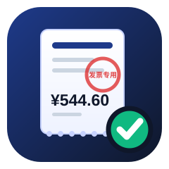
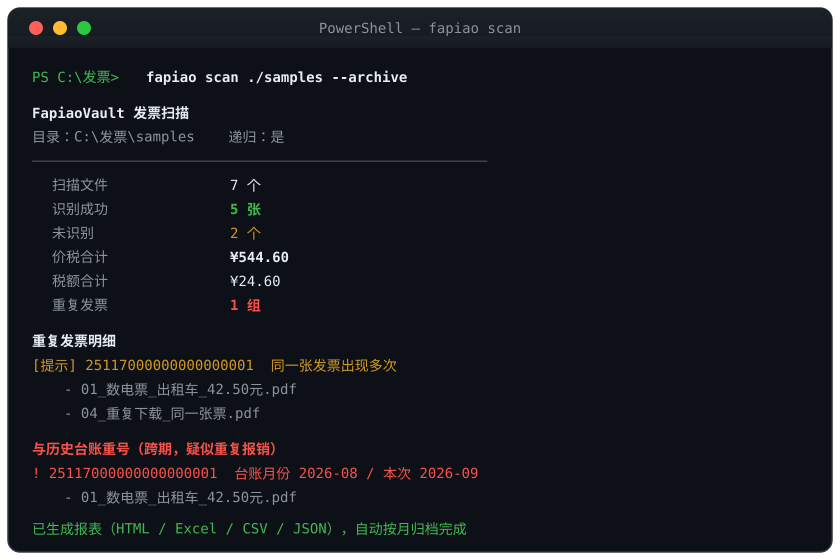
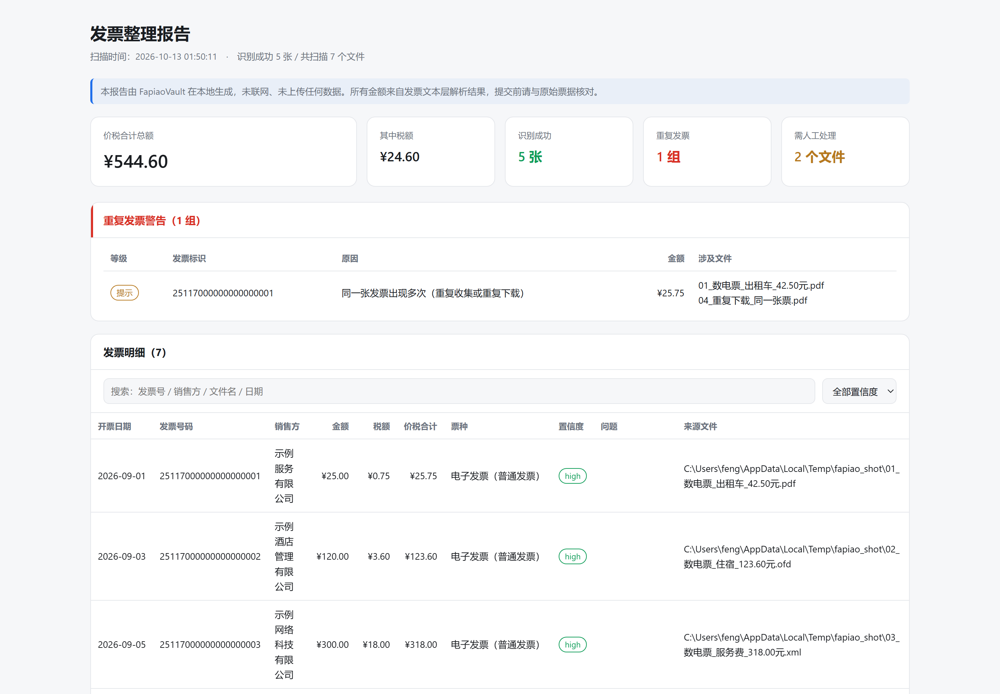

<div align="center">



# FapiaoVault

**Local-only Chinese e-invoice organizer, duplicate checker & expense summarizer**

No network · No uploads · No AI · No OCR

[](https://github.com/dfhhvc/fapiao-vault/actions/workflows/ci.yml)
[](LICENSE)
[](pyproject.toml)
[](https://github.com/astral-sh/ruff)

[中文](README.md) · **[English](README.en.md)**

</div>

---

> **Note:** This tool targets **Chinese electronic invoices** (数电票 / fully-digitalized
> e-invoices, and VAT e-invoices). The documentation below is in English for international
> contributors; the tool's UI and reports are in Chinese.

Dump a folder of messy invoice files (PDF / OFD / XML) into one directory, run one command,
and get: **deduplicated archives + an expense summary + an offline report.**

```bash
fapiao scan ./my-invoices --archive
```



## The report

Double-click `发票报告.html` to open the offline report — search, filtering, summaries,
and risk highlighting are all built in, with zero external resources loaded:



---

## Why

Anyone who files monthly expense reimbursements keeps doing the same chores:

- Invoices downloaded from email/WeChat/Alipay have **garbage filenames** (`dzfp_25512000000012345678_20260901.pdf`)
- The same invoice gets **downloaded twice** without you noticing — and duplicate
  reimbursement is a compliance red line
- You discover a **wrong header/tax ID** only when finance bounces your claim
- You hand-type amounts into Excel, and **one typo means redoing everything**

The common answer is uploading invoice images to a **cloud LLM for OCR**. That means your
invoices (company names, tax IDs, amounts, itineraries) leave your machine — and the
results are probabilistic.

**You don't need AI for this.** Modern Chinese e-invoices (PDF / OFD / XML) carry a
**text layer** with deterministic fields. Rule-based parsing is accurate, reproducible,
verifiable — and fully offline.

> Verify it yourself: unplug the network and the tool still works. Watch Task Manager:
> zero network requests.

---

## How it compares

| | FapiaoVault | Cloud OCR tools | Manual |
|---|---|---|---|
| Data leaves your machine | **Never** | Images uploaded | No |
| API key / network required | **No** | Yes | No |
| Extraction method | **Deterministic text-layer parsing** | LLM/OCR (probabilistic) | Eyeballs |
| Duplicate detection | **In-batch + cross-period ledger** | Rare | Memory |
| Header/tax-ID validation | **Yes (with check digit)** | Rare | Eyeballs |
| Speed | Milliseconds | Network-bound | Hours |
| Install size | **A few hundred KB** | Often hundreds of MB | — |

---

## Quick start

### 1. Install

```bash
git clone https://github.com/dfhhvc/fapiao-vault.git
cd fapiao-vault
pip install -e ".[pdf,excel]"
```

- `pdf`: PDF invoice parsing (the **only** third-party dependency; OFD and XML parse
  with the standard library)
- `excel`: `.xlsx` export (optional — degrades gracefully to CSV)

### 2. CLI

```bash
# Scan + generate reports
fapiao scan ./my-invoices

# Scan + archive by month with renamed copies (originals are never touched)
fapiao scan ./my-invoices --archive

# Check every invoice against your company header / tax ID
fapiao scan ./my-invoices --company "Some Tech Co., Ltd." --tax-id "91330100MA2XXXXXX2"

# Validate a Unified Social Credit Identifier
fapiao verify 91330100MA2XXXXXX2
```

Scanning produces a `_报表/` (reports) directory:

| File | Purpose |
|---|---|
| `发票报告.html` | **Offline visual report** — search, filter, summaries |
| `发票汇总.xlsx` | Three sheets: details / summary / duplicates |
| `发票明细.csv` | UTF-8 with BOM — opens cleanly in Excel |
| `台账.json` | Ledger — auto-read on the next scan to catch **cross-month duplicates** |

Archived output (monthly folders, collision-safe naming, never overwrites):

```
_归档/
└── 2026-09/
    ├── 2026-09-01_示例出行有限公司_42.50元_25117000000000000001_普通发票.pdf
    ├── 2026-09-03_示例酒店有限公司_123.60元_25117000000000000002_普通发票.ofd
    └── 2026-09-01_示例出行有限公司_42.50元_25117000000000000001_普通发票_2.pdf   ← duplicate copy
```

---

## What it checks

- **Cross-period duplicate reimbursement (highest risk)**: invoice number found in the
  **historical ledger** from a different month — flagged separately from in-batch duplicates
- **High-risk duplicates**: same invoice number appearing in **different months** within one scan
- **Duplicate collection**: same number in-batch, or identical file content (sha256)
- **Header mismatch**: buyer name differs from your company's
- **Tax-ID errors**: mismatch, or **check digit fails** (GB 32100-2015)
- **Arithmetic mismatch**: amount + tax ≠ total (beyond 1 cent)
- **Case-amount mismatch**: Chinese uppercase amount disagrees with the numeric one —
  a sign of tampering
- **Number format anomalies**: digital invoices are 20 digits with no invoice code;
  legacy ones are 12-digit code + 8-digit number

---

## Supported formats & deliberate limits

| Format | Support | Notes |
|---|---|---|
| PDF (digital / VAT e-invoices) | ✅ | Reads the text layer, no OCR |
| OFD | ✅ | **Parsed with the standard library** (OFD is just ZIP + XML) |
| XML (original digital invoice) | ✅ | Direct structured field access, zero error |
| Images (jpg / png / scans) | ❌ | **OCR deliberately excluded** — you'll be told which files to re-download |

Paper scans are out of scope on purpose: doing them right requires OCR, which would break
the "offline + deterministic" core promise.

---

## Privacy promises

| Promise | How to verify |
|---|---|
| Zero network requests | Run with the network off, or watch a packet capture |
| Nothing uploaded | No `requests` / `urllib` / `httpx` anywhere in the code |
| Originals untouched | Archiving **copies**; collisions get a suffix, never overwritten |
| No registry writes, no daemons | Pure CLI/library, exits when done |

The only writes go to your output directories (`_报表/` and `_归档/`).

---

## Tests

```bash
python -m unittest discover -s tests
```

**107 tests, zero test dependencies** (standard-library `unittest` only), covering:

- USCC check digits (with **hand-computed** vectors, not self-referential)
- Chinese uppercase amount parsing (yuan/jiao/fen, 万, 拾 boundaries)
- Multiple real-world & adversarial text layouts (clean blocks / tail-glued vertical labels / head-glued labels / per-char scattering)
- **End-to-end** parsing for PDF / OFD / XML (fixtures generated by code)
- Three-tier dedup, cross-period detection, ledger round-trip regression
- Report output (HTML self-containment & XSS escaping)
- Archive renaming and no-overwrite guarantees
- Full CLI surface

CI runs the suite on **Ubuntu / Windows × Python 3.9–3.13**, plus a `core-only` job
that installs **no extras** — guarding the zero-dependency promise.

---

## FAQ

**Q: Why no AI / OCR?**
A: Unnecessary and strictly worse here. E-invoices ship a text layer; rule-based parsing is
**deterministic** — same input, same output, testable, debuggable to a specific rule. OCR is
probabilistic and requires uploading images to third parties.

**Q: My invoice is an image.**
A: Re-download the original PDF/OFD/XML from the issuing platform (usually free and instant).
The tool tells you exactly which files fall into this category.

**Q: Could it lose my invoices?**
A: Archiving only copies. Originals are never moved, renamed, or deleted.

**Q: Can it handle hundreds of invoices?**
A: Yes — parsing is local string processing, millisecond-level.

---

## Contributing

Issues and PRs welcome — see [CONTRIBUTING.md](CONTRIBUTING.md) (in Chinese).
For security issues, see [SECURITY.md](SECURITY.md) — please don't file them publicly.

## License

[MIT](LICENSE)
